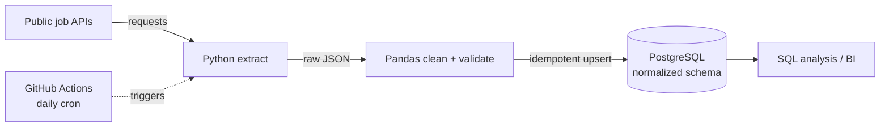

# Tech Job Market ETL Pipeline

Automated pipeline that collects daily tech hiring data from public APIs, stages it in a normalized PostgreSQL schema, and runs on a schedule with GitHub Actions.

**Stack:** Python · Pandas · PostgreSQL · GitHub Actions

## The problem
Hiring trends are scattered across job boards and change daily. A one-off scrape goes stale immediately, so the useful version is a pipeline that collects the data every day, keeps history, and never loads the same record twice.

## Architecture



## Approach
- **Extract:** Python pulls daily postings from public REST APIs.
- **Transform:** Pandas cleans the JSON payloads, standardizes fields and drops invalid rows.
- **Load:** data lands in a normalized PostgreSQL schema. Loads are idempotent, so reruns do not create duplicates.
- **Orchestrate:** a GitHub Actions cron workflow runs the pipeline daily and logs errors.

## Results
- Fully automated daily ingestion with no manual steps.
- A queryable history of hiring trends in a normalized relational model.

## Run it
```bash
git clone https://github.com/VasilenData/tech-job-market-etl.git
cd tech-job-market-etl
python -m venv .venv && source .venv/bin/activate
pip install -r requirements.txt
cp .env.example .env          # set your PostgreSQL connection string
python -m pipeline.run        # one full extract -> transform -> load cycle
```

## Status
Pipeline source code is being added to this repository. See also [HN Pulse](https://github.com/VasilenData/hn-pulse), a complete orchestrated project with dbt tests and a live dashboard.

---
Built by [Vasilen Kanchev](https://vasilendata.github.io) · [LinkedIn](https://www.linkedin.com/in/vasilen-kanchev-030878290/)
