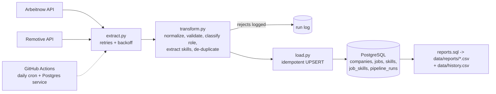

# Tech Job Market ETL Pipeline

Automated daily pipeline that pulls tech job postings from two public APIs, validates and normalizes them, loads them idempotently into a **PostgreSQL** schema, and commits daily trend reports. Runs on a schedule with **GitHub Actions**.

**Stack:** Python · PostgreSQL · GitHub Actions · pytest

## The problem
Hiring trends move daily and a one-off scrape goes stale. The useful version collects data every day, keeps history, never loads a record twice, and tells you when data is bad.

## Architecture



## Schema (normalized)
`companies` 1-to-many `jobs` many-to-many `skills` (through `job_skills`), plus `pipeline_runs` as an audit log (rows fetched, valid, rejected, inserted, updated per run). See [`sql/schema.sql`](sql/schema.sql).

## Engineering details
- **Idempotent loads:** `INSERT ... ON CONFLICT DO UPDATE` keyed on `source:id`. Running the pipeline twice back to back gave 875 jobs both times: 875 inserted on the first run, 0 inserted and 875 updated on the second.
- **Validation and rejects:** records without id, title or company are rejected and logged, never loaded. Duplicates within a batch are collapsed.
- **Role classification and skill extraction:** rule-based, unit tested. Word-boundary regexes avoid false hits (e.g. "Java" vs "JavaScript").
- **Resilience:** HTTP retries with exponential backoff; one source failing does not stop the other; the run only fails if every source fails.
- **Durable history:** CI databases are ephemeral, so each run appends to `data/history.csv` (active jobs per day and role family) and the workflow commits it. Point `DATABASE_URL` at a persistent Postgres to keep full job-level history instead.
- **Tests:** 6 tests, including an integration test against a real PostgreSQL that proves reloading does not duplicate rows.

## First run (real output, 29 Oct 2026)
875 postings loaded (864 Arbeitnow, 11 Remotive). Arbeitnow is a general European job board, so most postings are non-data roles: 723 other, 87 software, 47 data science/ML, 9 data analytics, 9 data engineering. Most-requested skills in the 9 data engineering roles: SQL (7), Python (4), ETL (3). This is a small sample from one day; the value grows as daily history accumulates in `data/history.csv`.

## Run it
```bash
git clone https://github.com/VasilenData/tech-job-market-etl.git
cd tech-job-market-etl
pip install -r requirements.txt
pytest -q
python -m pipeline.run          # embedded local PostgreSQL, nothing to install
# or use your own database:
DATABASE_URL=postgresql://user:pw@localhost:5432/jobs python -m pipeline.run
```
Reports land in `data/reports/` (daily postings, active roles by family, top skills for data engineering, top hiring companies).

## Data sources and terms
[Arbeitnow job board API](https://www.arbeitnow.com/blog/job-board-api) and [Remotive API](https://remotive.com/api/remote-jobs). Both are free; link back to the sources if you reuse the data and keep request volume low (this pipeline makes about 6 calls a day).

---
Built by [Vasilen Kanchev](https://vasilendata.github.io) · [LinkedIn](https://www.linkedin.com/in/vasilenkanchev/)
